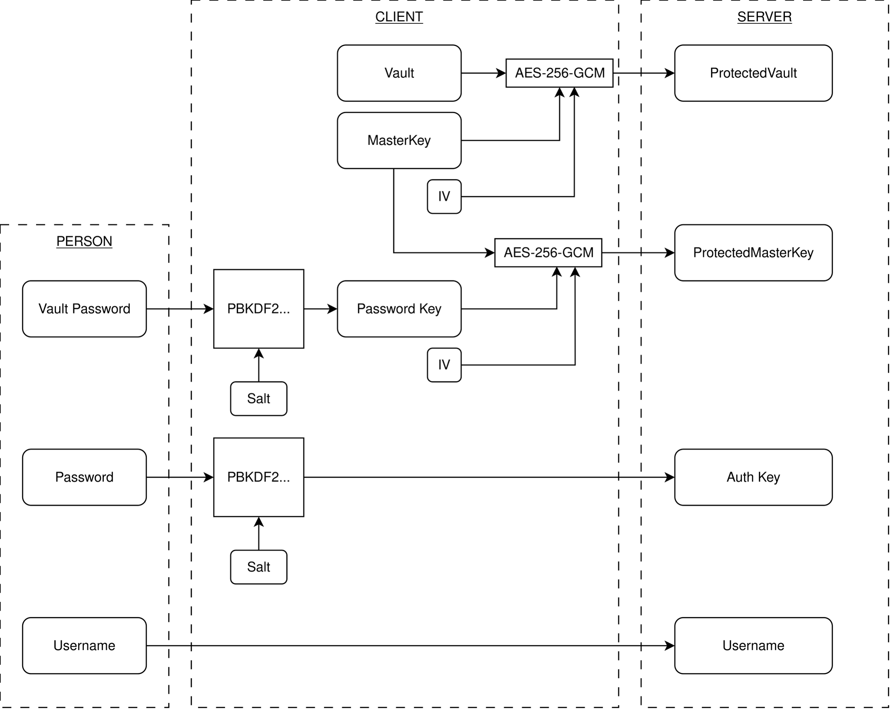

# Xenon

The **noble** password manager <s>backdoors included</s>.

Jokes aside, here are the premises this project follows:

1. No plain secret is ever sent to the server
2. All encryption/decryption happens client-side
3. Only cryptography primitives directly available on the browser ([Web Crypto API](https://developer.mozilla.org/en-US/docs/Web/API/Web_Crypto_API)) are used
    - External JS libraries for cryptography on client side will not be used
4. Authentication and decryption are handled separately by using two passwords:
    - One password authorizes a specific user to reveive their encrypted vault 
    - The other will be used to derive the key to decrypt the vault

## Primitives used

- Encryption/decryption: AES in Galois/Counter Mode
    - length: 256 bits
- Key derivation: PBKDF2
    - Number of iterations: 600000
    - Hashing: SHA-512

## Architecture



## Install (development)

### 1. Deploy the database container and run the migrations

```bash
docker compose build db migrate
docker compose up db migrate -d
```

### 2. Activate the venv and install dependencies

```bash
python -m venv venv
source ./venv/bin/activate
pip install -r requirements.txt
```

### 3. Run in dev mode with debugger and hot reload enabled

Set `JWT_SECRET_KEY` to a random value of at least 32 bytes before starting the
server, for example with `export JWT_SECRET_KEY="$(openssl rand -hex 32)"`.

Click on the "Run and debug" button on VSCode to run the server using the config
provided on `.vscode/launch.json`

### Authentication

Fetch `/user/{username}/salt`, derive the authentication key in the client, then
POST it as the `password` form field with the `username` field to `/user/token`.
The response contains an OAuth2 bearer `access_token`; send it in the
`Authorization: Bearer <access_token>` header when accessing user, vault, or
master-key endpoints. Tokens expire after 30 minutes.